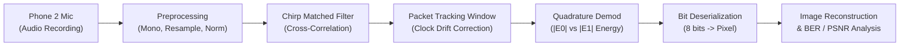

# Acoustic Binary FSK Smartphone Image Transmission & BER Analysis

An end-to-end digital communications and acoustic modem system implemented in MATLAB. This project transmits digital images over the air between two smartphones using Binary Frequency Shift Keying (BFSK) at 400 bps with audio chirps, matched-filter synchronization, non-coherent quadrature energy demodulation, forward error correction (Repetition & Hamming), and DBPSK comparison.


---

## 📌 System Overview

Standard smartphone speakers and microphones suffer from non-linearities, room multipath reverberation, ambient acoustic noise, and oscillator clock drift (~100 ppm). This project solves these challenges by implementing:
1. **LFM Chirp Preamble Synchronization**: 100 ms linear frequency modulated chirp ($1000\text{ Hz} \to 4000\text{ Hz}$) preceding each 256-bit packet.
2. **Per-Packet Matched Filtering & Tracking Window**: Dynamic search window ($\pm 300\text{ samples}$) tracking clock jitter across multi-second transmissions.
3. **Non-Coherent Quadrature Demodulation**: Compares envelopes $|E_0|$ and $|E_1|$ without requiring phase locking or carrier recovery.
4. **Error Control Coding**: Implementation of Repetition(3) and systematic Hamming(7,4) syndrome decoders.
5. **DBPSK Alternative**: Evaluates Differentially Coherent BPSK to demonstrate a $3\text{ dB}$ power gain and $2\times$ spectral efficiency.

---

## 🏗️ System Architecture

### Transmitter Chain (Phone 1)


### Receiver Chain (Phone 2)


---

## 📊 Packet Frame Structure

```
+------------------------------------+------------------------------------------------+
|       Linear Chirp Preamble        |            FSK Data Payload Bits               |
|  1000 Hz -> 4000 Hz (100 ms, Hann) |       256 bits @ 400 bps (640 ms, 120 sps)     |
+------------------------------------+------------------------------------------------+
|<---------- 4800 samples ---------->|<---------------- 30720 samples --------------->|
```

- **Sampling Rate ($F_s$)**: $48{,}000\text{ Hz}$
- **Bit Rate ($R_b$)**: $400\text{ bps}$ ($T_b = 2.5\text{ ms}$, $\text{sps} = 120$)
- **Mark Frequency ($f_0$)**: $2000\text{ Hz}$ ($5\text{ cycles/bit}$)
- **Space Frequency ($f_1$)**: $3200\text{ Hz}$ ($8\text{ cycles/bit}$)
- **Tone Separation ($\Delta f$)**: $1200\text{ Hz} \ge R_b$ (strict non-coherent orthogonality)

---

## 📂 Repository Structure

| File | Description |
|---|---|
| `fsk_tx.m` | Transmitter script: converts image to audio packets and exports `fsk_image.wav` and `txdata.mat` |
| `fsk_rx.m` | Receiver script: processes phone recording, performs matched filtering, demodulates bits, and reconstructs image |
| `extension_a_distance_noise.m` | Simulates BER across acoustic transmission distances ($0.1\text{m}$ to $2.5\text{m}$) and ambient noise |
| `extension_b_channel_coding.m` | Evaluates Uncoded FSK vs Repetition(3) vs Systematic Hamming(7,4) Forward Error Correction |
| `extension_c_dbpsk.m` | Comparative analysis between BFSK and Differential BPSK (speed, spectral occupancy, PSNR) |
| `extension_d_sim_ber.m` | 60,000-bit Monte-Carlo AWGN simulation validating empirical BER against theoretical formulas |
| `report_outline.md` | Full engineering project outline with mathematical derivations, schematics, and results |
| `ADC_Lab_Report_FSK_Image_Transmission.pdf` | Comprehensive, formatted engineering lab report PDF |
| `extension_a_results.png` | Output plots for distance sweep and acoustic path loss |
| `extension_b_results.png` | Output plots for FEC coding comparison and reconstructed sample images |
| `extension_c_results.png` | Output plots for DBPSK vs BFSK spectral efficiency and visual fidelity |
| `extension_d_results.png` | Output plots for Monte-Carlo simulation vs analytical $P_e$ theory curves |
| `lion.jpg` / `image.png` | Test images used for transmission benchmarks |
| `fsk_image.wav` / `received.mp3` | Sample transmitted audio and actual smartphone microphone recording |

---

## 🚀 Quick Start & Usage

### 1. Generating Transmitted Audio
```matlab
% Run in MATLAB
fsk_tx
```
- Reads input image (`lion.jpg` or `image.png`), converts to binary stream, frames into packets with chirp headers.
- Produces `fsk_image.wav` (playable audio file) and `txdata.mat` (reference metadata).

### 2. Over-The-Air Smartphone Experiment
1. Transfer `fsk_image.wav` to **Phone 1** (Transmitter).
2. Position **Phone 2** (Receiver) at the desired distance (e.g., $0.25\text{ m}$ to $1.0\text{ m}$).
3. Start voice/audio recording on Phone 2.
4. Play `fsk_image.wav` on Phone 1 at normal listening volume.
5. Save the recording as `received.mp3` (or `.wav` / `.m4a`) and copy back to the workspace.

### 3. Demodulating & Reconstructing Image
```matlab
% Run in MATLAB
fsk_rx
```
- Matches chirp signatures, locks onto packet timestamps, computes non-coherent energy, restores pixels, and reports BER!

---

## 🔬 Experimental Findings & Extensions

### Extension A: Distance & Noise Sweep
Acoustic sound pressure decays with distance as $P(d) \propto 1/d$ ($20\log_{10}(d/d_0)\text{ dB}$ loss). 
- Distances $\le 0.5\text{ m}$: Error-free transmission ($\text{BER} = 0.00\%$).
- Beyond $1.5\text{ m}$: Multipath and room noise trigger gradual pixel salt-and-pepper degradation.

### Extension B: Channel Coding (Repetition vs Hamming)
- **Uncoded ($R=1.0$)**: High sensitivity to low SNR.
- **Hamming(7,4) ($R=0.57$)**: Corrects all single-bit errors with only $+75\%$ overhead. BER drops from $6.90\%$ to $3.44\%$ at $6\text{ dB}$.
- **Repetition(3) ($R=0.33$)**: Majority voting slashes BER by $80\%$ down to $1.42\%$ at $6\text{ dB}$.

### Extension C: DBPSK vs Binary FSK
- DBPSK operates on a single carrier ($2500\text{ Hz}$), halving occupied bandwidth ($800\text{ Hz}$ vs $1600\text{ Hz}$).
- Achieves $+9.8\text{ dB}$ image PSNR advantage over BFSK at identical $E_b/N_0$ ($26.09\text{ dB}$ vs $16.28\text{ dB}$).

### Extension D: Monte Carlo vs Theory
Validates analytical non-coherent FSK error probability:
$$P_{e,\text{FSK}} = \frac{1}{2} \exp\left(-\frac{E_b}{2 N_0}\right)$$
Demonstrates the exact $3\text{ dB}$ power penalty of non-coherent detection relative to DBPSK ($P_e = \frac{1}{2}\exp(-E_b/N_0)$).

---

## 📜 License
MIT License. Open-source educational and engineering resource.
